<!-- README.md is generated from README.Rmd. Please edit that file -->

# tsstructure

<!-- badges: start -->

<!-- badges: end -->

The goal of tsstructure is to …

## Installation

You can install the development version of tsstructure from
[GitHub](https://github.com/) with:

``` r
# install.packages("pak")
pak::pak("thiyangt/tsstructure")
```

## Example

This is a basic example which shows you how to solve a common problem:

``` r
library(tsstructure)
library(mgcv)
#> Loading required package: nlme
#> This is mgcv 1.9-4. For overview type '?mgcv'.

set.seed(123)

n <- 200
t <- seq_len(n)

y1 <- 10 + 3 * sin(2 * pi * t / 50) +
  rnorm(n, sd = 0.3)
randomness_ratio_gam(y1)
```

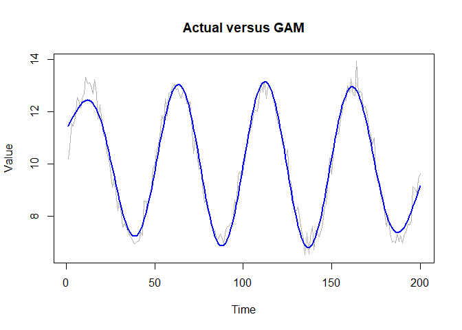

    #> [1] 0.03313283
    randomness_ratio_loess(y1)

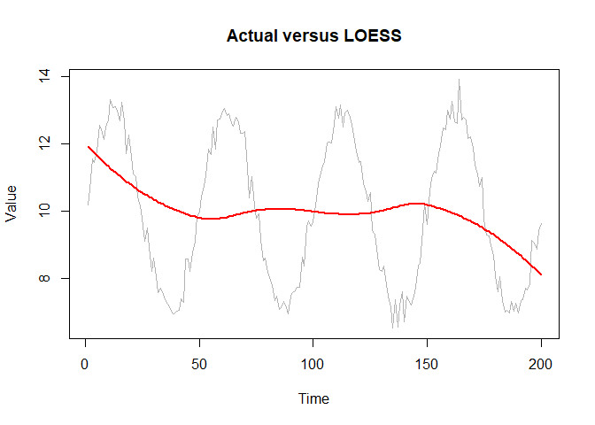

    #> [1] 0.9077755

    y2 <- rnorm(200)

    randomness_ratio_gam(y2)

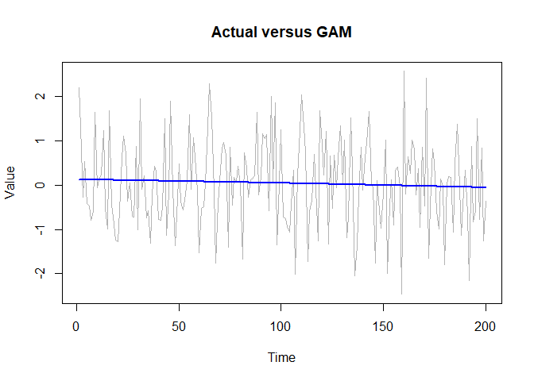

    #> [1] 0.9967429
    randomness_ratio_loess(y2)

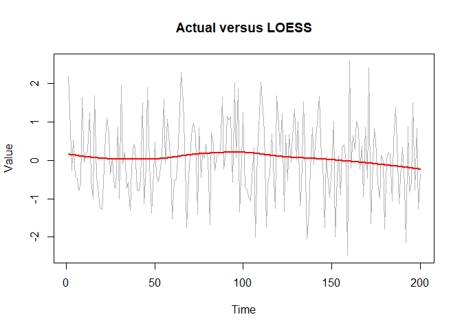

    #> [1] 0.9846733

``` r
set.seed(123)

n <- 200
t <- 1:n

# Linear
y_linear <- 10 + 0.05 * t + rnorm(n, 0, 0.3)
randomness_ratio_gam(y_linear)
```

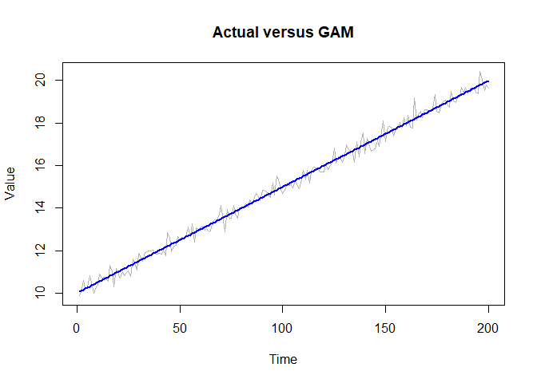

    #> [1] 0.00953499
    randomness_ratio_loess(y_linear)

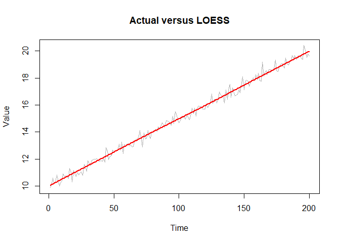

    #> [1] 0.009498872

    # Nonlinear quadratic
    y_curve <- 10 + 0.002 * (t - 100)^2 + rnorm(n, 0, 0.3)
    randomness_ratio_gam(y_curve)

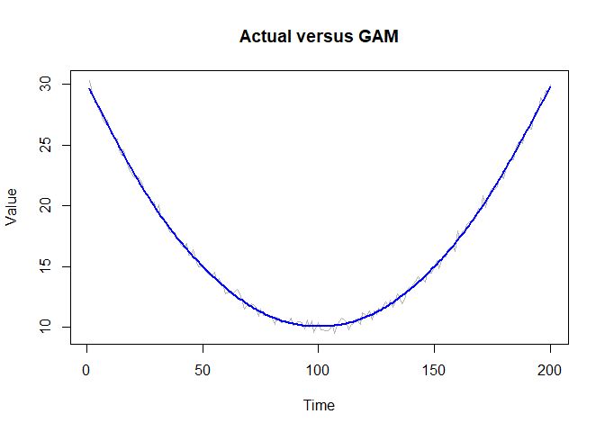

    #> [1] 0.002507062
    randomness_ratio_loess(y_curve)

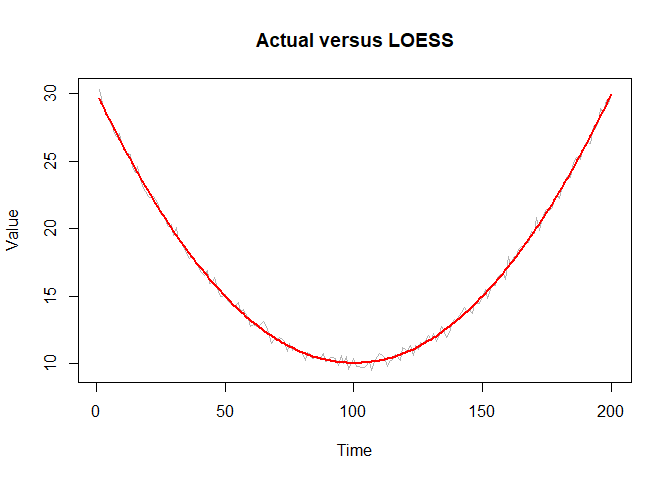

    #> [1] 0.002470385

    # Sine wave
    y_sine <- 10 + 3 * sin(2 * pi * t / 50) + rnorm(n, 0, 0.3)
    randomness_ratio_gam(y_sine)

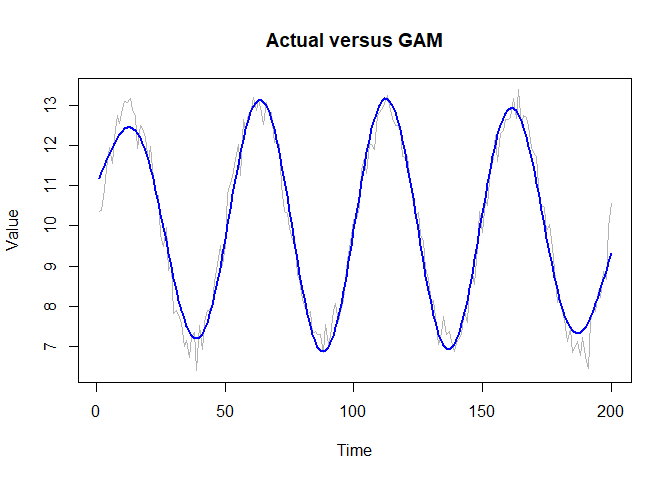

    #> [1] 0.03402271
    randomness_ratio_loess(y_sine)

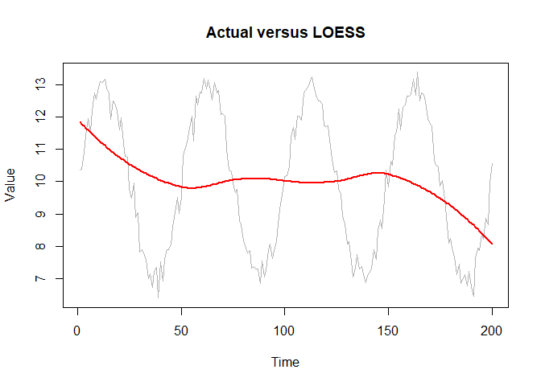

    #> [1] 0.9097413

    # Highly random
    y_random <- 10 + rnorm(n, 0, 3)
    randomness_ratio_gam(y_random)

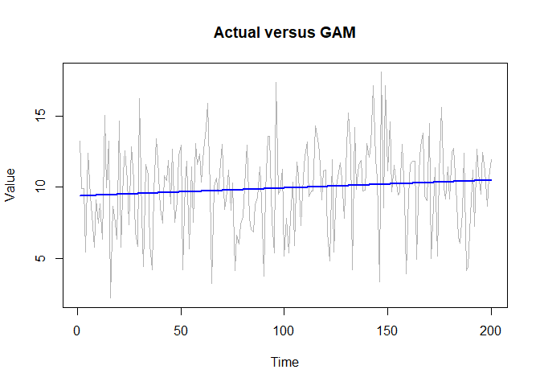

    #> [1] 0.9891118
    randomness_ratio_loess(y_random)

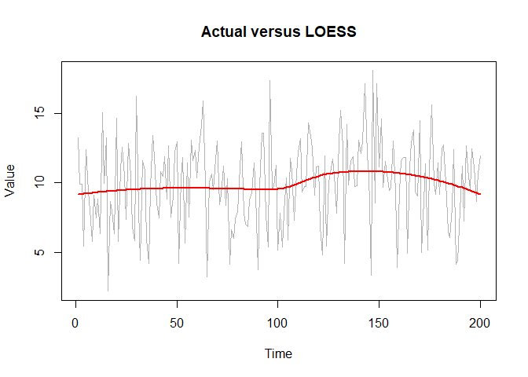

    #> [1] 0.9654004
